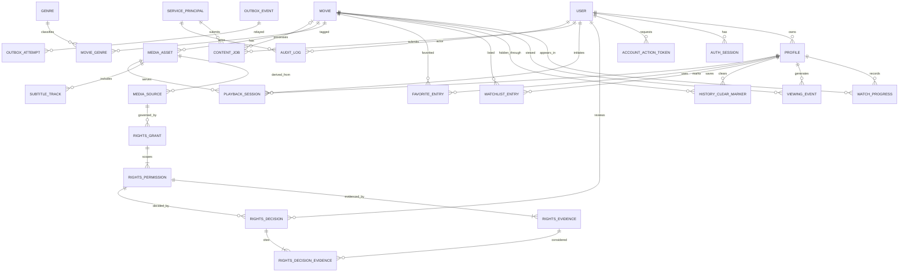

# Initial Data Model (Proposal)

**Status:** Draft. This logical ERD is not a migration or approved schema. Exact jurisdictional rights evidence fields, retention, identity requirements, and access targets need product/legal decisions.

## ERD

## Entities, ownership, and constraints

| Entity | Owner / purpose | Important relationships and constraints |
|---|---|---|
| User | Identity; login and account status | unique normalized email/subject; never expose credential hash; account status and timestamps |
| AuthSession | Revocable browser session | hashed opaque token identifier; user FK; expiry/revoked/rotated timestamps; store no raw bearer secret |
| AccountActionToken | Email verification or password recovery challenge | user FK nullable until registration resolve; token hash only; purpose, created/expiry/consumed/revoked timestamps; one-time use; no raw token stored; expiry duration is policy |
| Profile | User-facing viewing identity | user FK; unique `(user_id, normalized_name)` or documented profile limit; account ownership enforced |
| Movie | Canonical catalog metadata | stable ID/slug; publication projection derived from rights and media readiness; normalized title/search fields |
| Genre | Controlled genre taxonomy | unique stable slug; avoid user-controlled arbitrary taxonomy unless designed |
| MovieGenre | Join | unique `(movie_id, genre_id)` |
| MediaSource | Provenance and playback/ingest route | `source_mode` distinguishes `hosted_asset` from `authorized_provider_playback`; source kind, provider identifier, source checksum where bytes are acquired; encrypted provider credentials in a separate secret store; provider playback mode must not imply downloaded or rehosted media rights |
| RightsGrant | Rights package grouping related review scopes | source FK, optional asset FK, grant identifier/metadata; has no blanket approval state that authorizes all scopes |
| RightsPermission | One independently assessable authorization | grant FK; exactly one category (`acquisition`, `temporary_storage`, `permanent_storage`, `derivative_transcode`, `cdn_redistribution`, `third_party_provider_playback`); territories, effective interval, attribution, restrictions, current status projection; enforce checks independently |
| RightsEvidence | Evidence supporting one permission scope | mandatory `rights_permission_id` FK; evidence locator, hash, source, added_by actor/time; access restricted/audited; one permission decision cannot borrow evidence attached only to another permission |
| RightsDecision | Immutable approval/rejection/revocation record | permission FK; reviewer user FK; decision UUID, action, reason, effective/recorded timestamps; no service principal can act as rights reviewer; append each decision rather than overwriting prior history |
| RightsDecisionEvidence | Evidence considered for a decision | decision FK + evidence FK; only evidence attached to the same permission may be cited; records exact scope proof used in that decision |
| MediaAsset | Encoded immutable asset version | movie FK; version/status; private object prefix; codec/manifest metadata; only validated version may be active |
| SubtitleTrack | Language/caption metadata and storage reference | asset FK; format (e.g. WebVTT), language, label, kind, object key; validate before publish |
| WatchProgress | Latest resume position only | unique `(profile_id, movie_id)`; position >= 0; updated_at, session sequence/version for conflict handling; mutable projection, not viewing history |
| ViewingEvent | Append-only playback/history facts | profile/movie/playback-session FKs; event type (`started`, `progress_checkpoint`, `completed`, `stopped`), event timestamp, position, session sequence/idempotency key; deduplicate retries and define retention/consent policy |
| HistoryClearMarker | User-visible history clear boundary | profile/movie FKs; `hidden_through` timestamp, created_at/request ID; history reads omit older events; immutable events may be physically removed later under approved retention/deletion policy |
| WatchlistEntry | “Watch later” collection | unique `(profile_id, movie_id)`; created_at; authorization via profile owner |
| FavoriteEntry | Explicit positive preference, distinct from watch-later intent | unique `(profile_id, movie_id)`; created_at; authorization via profile owner; both collections are retained as product features; exact UX semantics and retention remain open |
| PlaybackSession | Short-lived playback authorization/audit | user/profile FKs; `delivery_mode` hosted CDN or authorized provider; nullable asset-version FK and provider/source FK; created/expiry/revoked; territory and rights decision context; opaque provider grant reference only; do not persist raw signed URL/token |
| ContentJob | Durable ingestion/processing workflow | submitted_by user or service principal; optional movie; state machine, idempotency key, retry count, safe error code, timestamps; unique idempotency key per requester/scope |
| OutboxEvent | Transactional intent to publish an event | event UUID; aggregate type/id/version; event type/schema version; payload; state `pending|leased|published|dead`; created/available/lease owner/lease expiry/attempt count/published timestamps; unique dedupe key; inserted in same transaction as business state change |
| OutboxAttempt | Relay diagnostic/attempt record | outbox event FK; attempt number, start/end, outcome, retry-after, safe error code; bounded retention; never stores secrets |
| ServicePrincipal | Non-human caller identity | stable principal ID, status, owner/purpose, scoped permissions, credential reference (secret store only), created/rotated/revoked timestamps; no shared human login |
| AuditLog | Sensitive admin/rights and service actions | actor type `user|service_principal`, actor ID, action, subject type/id, before/after digest or approved diff, reason, timestamp, request/correlation ID; append-only policy and retention decided |

Viewing history and resume state are different: `ViewingEvent` preserves a minimal append-only record of playback activity, while `WatchProgress` contains the latest resume position. `HistoryClearMarker` hides events from user-facing history without mutating the event ledger; physical deletion/anonymization follows approved retention/privacy policy. Both watch-later and favorites remain separate product features; exact UX semantics and retention/deletion behavior require product/privacy approval.

## Ownership and invariants

- User owns profiles and authenticated sessions. Profile is the access boundary for watchlist, favorites, viewing events, and resume progress unless product explicitly chooses account-level ownership.
- Movie metadata is not evidence of streaming rights. `RightsGrant` approval must be independent of ingest technical success.
- Hosted playback requires independently valid acquisition, storage (temporary for processing and permanent for retained origin), derivative/transcode, and CDN redistribution grants for territory/time. Do not infer one permission from another.
- Authorized third-party provider playback requires a provider identity and explicit grant for provider playback in territory/term; it does not authorize CINEFLOW acquisition, storage, transcoding, or CDN rehosting. Provider token/credential references are not database plaintext.
- Playback remains blocked when trusted viewer territory cannot be established or the selected edge/provider cannot enforce the approved post-revocation access bound. Trusted territory source/confidence and maximum residual access time after revocation are unapproved policy inputs.
- Each `RightsPermission` independently models territory, effective interval `[starts_at, ends_at)`, action, attribution, restrictions, and its own required evidence set. `RightsDecision` rows hold immutable reviewer decision IDs/times and `RightsDecisionEvidence` binds the evidence considered. A `RightsGrant` groups permission records only; it cannot be approved once to implicitly approve all child scopes. Decisions apply to one `rights_permission_id` and cite only evidence attached to that permission. Counsel and provider terms must validate exact categories and fields.
- Every content-processing job and state transition that must publish asynchronously has an outbox event committed atomically with the business state. Relay is at-least-once; consumers deduplicate by event ID/business idempotency key.
- Asset versions and output object keys should be immutable; publication changes active reference transactionally.
- Every sensitive state change (rights approval/revocation, publish/unpublish, source change, admin account action) is audited.

## Initial access patterns

1. Search/list published movies by genre/year/text, stable sort, cursor pagination.
2. Fetch movie detail + genre + currently available subtitle and playback eligibility summary.
3. Fetch user profiles; enforce account scope.
4. Read/update one profile's watchlist and progress keyed by profile/movie.
5. Check rights by asset, territory, status, effective interval at playback issuance.
6. Fetch content job state by admin and status; workers claim/transition by job ID and idempotency key.
7. Poll outbox events due for dispatch; claim by lease expiry/available-at and inspect attempts.
8. Fetch history events separately from current resume progress; query favorites and watchlist as distinct profile collections.
9. Audit queries by subject, actor type/ID, and time with restricted admin access.

Add indexes only against measured query shapes. Candidate constraints/indexes include unique email, `(profile_id, movie_id)` uniqueness, movie genre lookup, published/status + stable sort, rights lookup on `(asset_id, territory, status, starts_at, ends_at)` after query-plan validation, job state/created ordering, and audit subject/time. PostgreSQL range/exclusion constraints for overlapping rights grants may be appropriate but require careful modeling of territory/use dimensions and DBA validation.

## Migration and data lifecycle

### Outbox relay semantics proposal

- **Delivery:** At-least-once; a crash after broker publish but before marking published may redeliver. Consumers must deduplicate by immutable `event_id` and/or aggregate version/idempotency key and make effects idempotent. No exactly-once claim.
- **Claim/lease:** Relay claims due rows transactionally (e.g. `FOR UPDATE SKIP LOCKED`), sets `lease_owner` and `lease_until`, then publishes outside the row-lock transaction. Expired leases are reclaimable. Proposed lease is 60 seconds; tune against broker timeout and deployment.
- **Retry:** On transient failure, increment attempts and set `available_at` using bounded exponential backoff with jitter. Proposed max 12 delivery attempts / 24 hours; leave as `dead` for operator review thereafter. Persist only sanitized error class/message.
- **Poison events:** Schema-invalid or deterministic rejected events are quarantined/dead-lettered, alerted, and not silently discarded. Operator may correct/replay only with an audit action and stable event identity/dedupe handling.
- **Retention:** Published rows proposed to retain 7 days before purge/archive; dead rows retained 90 days or per incident/legal policy. These durations are provisional; audit and rights evidence retention is separate and must not inherit outbox cleanup rules.
- **Observability:** Queue depth, oldest age, attempt count, lease expiry, dead count, and publish latency are measured without high-cardinality or secret-bearing labels.

Schema changes are Alembic migrations, reviewed for locks/backfill size and tested on fresh and upgrade paths. Define deletion/anonymization and retention rules for accounts, session rows, viewing events/progress, audit evidence, and media assets by jurisdiction and contract before launch. Do not cascade-delete licensing/audit records without a documented legal retention policy. Back up PostgreSQL and test restores; media object lifecycle/version cleanup must reconcile against active DB asset references.
