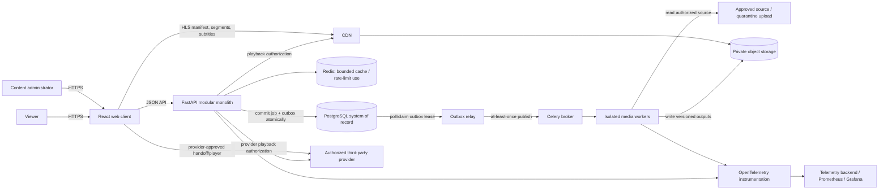
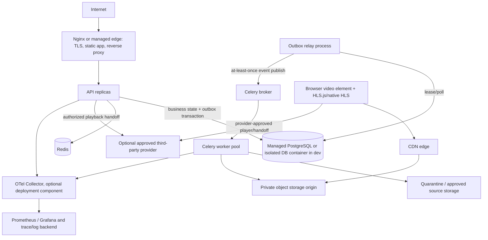

# System Architecture (Proposal)

**Status:** Draft for Architect review. No issue IDs, runtime code, or deployment have been supplied. Diagrams are logical proposals, not deployed topology.

## Goals and boundaries

Start with one modular-monolith API and one relational system of record. Keep media bytes, media processing, and media delivery outside the API process. Separate API modules by domain while retaining transactional simplicity. Add service boundaries only in response to measured scale or independent operational needs.

## System context

The diagrams show the hosted-media route and an optional authorized-provider playback route. They are logical proposals, not provider integrations or deployed topology.

CDN media delivery should not route segments through FastAPI. Redis, broker and cache roles must be explicitly separated/configured even if initially sharing a Redis deployment; production durability and failure implications must be reviewed before choosing Redis as Celery broker.

## Container / deployment view

For local development, Compose can supply API, PostgreSQL, Redis, outbox relay, broker, worker and Nginx. Production should prefer managed database/object storage/CDN where cost and region allow; Compose is not an HA orchestrator. Exact deployment topology is undecided. The third-party provider lane is optional and omitted unless a provider is approved; it does not imply media acquisition or rehosting authority.

## Component boundaries

| Module | Owns | Calls / dependencies |
|---|---|---|
| Identity & Access | user accounts, sessions, profiles, role policy | PostgreSQL; auth dependencies at API edge |
| Catalog | movie metadata, genres, availability projection | PostgreSQL; rights status read through policy boundary |
| Rights & Sources | source records, grants/licenses, territory/time/attribution, approval/revocation | PostgreSQL; audit log; no implied external provider |
| Library | watchlists, favorites, viewing-history events, resume progress | PostgreSQL; profile-scoped authorization |
| Playback | session/grant authorization, asset version selection, progress endpoint | Identity, Rights, Catalog, PostgreSQL, provider-specific signer adapter |
| Ingestion & Processing | content job state, probe/transcode/validate/promote orchestration | PostgreSQL, broker, storage adapter, isolated FFmpeg workers |
| Admin | management workflows and audit actions | domain service APIs; never bypasses domain authorization |
| Search/Discovery | filters, catalog query, ranking and collections | Catalog/read model; PostgreSQL initially |
| Telemetry | structured logs, metrics, traces | OTel APIs/SDK; export backend configuration |

Cross-module access is through service interfaces and explicit transaction boundaries, not direct imports of private persistence internals. Keep shared primitives small (IDs, clock, config, errors, authorization context).

## Request and playback flows

### Discovery

1. Client requests catalog collections/search with bounded pagination and validated filters.
2. Search module queries PostgreSQL and returns only publishable assets.
3. Publication eligibility must exclude content whose rights are revoked, outside term, or outside requested territory. Cache only with bounded staleness and invalidation strategy.

### Playback

1. Authenticated client requests a playback session for a movie/profile.
2. Playback service enforces account/profile entitlement and checks the rights route appropriate to the chosen source. For hosted assets it checks distinct acquisition, storage, derivative/transcode, and CDN redistribution permissions for the requested territory and time. A provider-playback source requires an explicit provider grant for playback in the territory/term; it does not imply downloading, storing, transcoding, or CDN rehosting rights.
3. Service creates auditable playback session and returns either a short-lived, scoped CDN grant for hosted assets or an authorized provider playback handoff/URL through a provider adapter. Provider response fields, player SDK, origin, and token handling are provider-specific and must be reviewed before integration.
4. Browser uses native HLS when supported or HLS.js when MSE supported for compatible manifests; provider-specific playback may require a separate supported player path. Every child request must remain covered by the authorized provider/CDN control and correct CORS/cache rules.
5. Client periodically sends progress with playback-session identifier and position; server validates ownership, asset/session and update policy, recording a distinct viewing event and updating resume progress.

Never emit a private object-storage origin URL or unrestricted storage credential. The exact signed-cookie/path-token/URL approach depends on CDN provider and requires an architecture decision after selection. An authorized provider handoff is a separate provider-controlled path and may be returned only when the provider terms and playback grant permit it. Signed values are bearer secrets; scrub from logs/referrers and keep lifetime short.

### Rights and playback-source separation

Rights are represented per grant and permission scope, not as a single boolean `licensed` flag. Proposed categories include acquisition/ingest, temporary processing storage, durable/permanent storage, derivative creation/transcoding, CDN/public redistribution, and playback through an authorized third-party provider. Every scope carries its own evidence references, reviewer/decision identity and time, permitted territories, effective term, attribution obligations, restrictions, and revocation status. A grant groups scopes but does not make them an all-or-nothing approval. The rights reviewer must only enable workflow stages supported by the evidence for that specific scope. Temporary storage is not permanent storage authority; a provider's playback entitlement does not authorize CINEFLOW to copy, transcode, or rehost its media. Exact legal categories, term semantics, evidence sufficiency, trusted territorial resolution, and revocation handling require legal/provider review. Playback remains denied unless trusted territory, currently valid per-scope rights, and an approved bounded expiry/revocation policy are available. Proposed maximum residual access after revocation is five minutes, unapproved and subject to CDN/provider capability and legal/security approval.

### Ingestion / processing

1. Authorized administrator submits metadata and a source record; system requires rights evidence before publish.
2. Ingest creates durable `ContentJob` state and outbox event in the same DB transaction. Avoid a dual-write-only enqueue pattern.
3. Worker fetches only from approved source paths or a quarantined upload. Arbitrary URL fetching is disabled by default; if later enabled, apply SSRF defenses in [security research](../research/security-research.md).
4. Isolated worker probes and validates source, stages versioned HLS renditions/subtitles/posters in private storage, validates playlists/segments, and records checksums.
5. Promotion changes the DB asset-version pointer only after successful validation; failed jobs remain inspectable/retryable, with idempotent job keys and bounded retries.
6. Rights approval and technical readiness are separate gates; processing success alone never publishes content.

## API contract source

[api-contracts.md](api-contracts.md) is the sole source for proposed endpoint paths, schemas, status codes, authorization rules, pagination, idempotency, and rate-limit behavior. That contract remains a proposal pending approval; changes must be reviewed there to avoid a duplicate outline drifting out of sync. Validate request schemas with Pydantic and serialize explicit response DTOs, not ORM entities.

## Security architecture

- TLS at trusted edge; trust forwarded headers only from that edge.
- First-party browser auth proposal: opaque server-side session cookie with Secure, HttpOnly, appropriate SameSite and CSRF defenses. Confirm if mobile/delegated OAuth clients are in scope.
- Service-level authorization checks user/profile ownership for every access; deny by default. Admin operations are separately privileged and audited.
- Rights policy is checked independently for acquisition, temporary/permanent storage, derivative/transcode, CDN redistribution, territory, term, attribution/restrictions, and revocation; third-party playback authorization does not imply rehosting permission.
- Admin user and service-principal actions are audited with actor type/ID, permission, target, request/correlation ID, timestamp, and decision reason. Service principals use scoped identities and cannot impersonate a human reviewer.
- Private origin and scoped CDN token; no storage credentials in browser. Redact grant query parameters from logs.
- Isolated media workers with CPU/memory/disk/process/time caps and least-privilege storage access; parser inputs are untrusted.
- Secrets delivered by secret manager/environment injection, never committed or baked into images.
- Security-sensitive design remains subject to independent threat review; see [security research](../research/security-research.md).

## Failure modes and expected behavior

| Failure | Required behavior |
|---|---|
| PostgreSQL unavailable | Fail requests that require authoritative state; bounded retries only for idempotent operations; never claim success without commit |
| Redis/cache unavailable | Bypass reconstructible cache where safe; apply explicit rate-limit policy; queue outage blocks job acceptance with a retryable response rather than fake success |
| Duplicate/lost task delivery | Idempotent worker keyed by job/version; reconcile DB job state and object outputs; no assumption of exactly-once execution |
| Worker crash/transcode timeout | Persist failed/retryable state, clean or expire staging output, cap retries and surface actionable safe error |
| Partial output or invalid playlist | Do not promote asset pointer; retain diagnostics and quarantine staged files for cleanup |
| CDN/origin outage | Playback fails gracefully with retryable UX; alert on origin/CDN error and cache metrics; API remains independent where feasible |
| Rights revoked/expired | Deny new playback and remove discoverability; expire/revoke edge grants to bounded TTL and preserve audit record |
| Telemetry backend outage | Application continues; bounded local buffering/drop policy; never block request or media processing on telemetry export |
| External metadata/provider outage | Preserve local canonical metadata; mark integration state stale and do not invent/fabricate successful data |

## Deployment / observability direction

Stateless web/API replicas, separate bounded worker pool, PostgreSQL backups/PITR, private object store, CDN, and independently monitored queue. Instrument API request latency/error/throughput, DB pool and query latency, queue age/depth, worker duration/failure, output bytes, CDN hit ratio/origin failures, and privacy-reviewed startup/rebuffer outcomes. Prometheus is operational monitoring, not an exact user analytics ledger. Define SLO and retention targets before sizing or production readiness claims.

## Research dependencies

- [Backend research](../research/backend-research.md)
- [Database research](../research/database-research.md)
- [Streaming research](../research/streaming-research.md)
- [Infrastructure research](../research/infrastructure-research.md)
- [Security research](../research/security-research.md)
- [Compatibility matrix](../research/compatibility-matrix.md)
