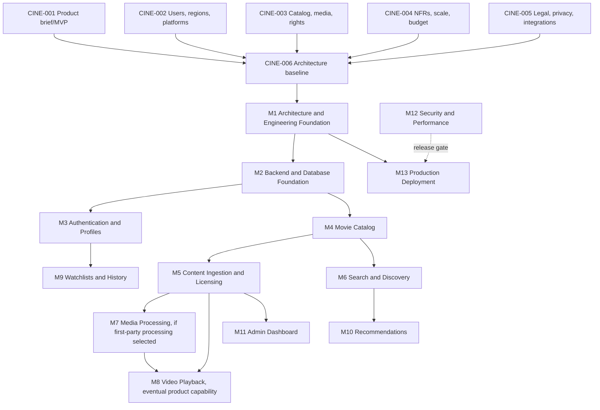

# Dependency Graph

## Blocking, parallel, critical path

CINE-001–005 are independent discovery deliverables and may run in parallel. CINE-006 blocks implementation and depends on all five. M1–M13 have no implementation-ready child issues. Arrows after CINE-006 show proposed sequencing and remain subject to approved contracts; they do not make any eventual product capability optional.

Critical path: CINE-001–005 → CINE-006 → M1 → approved MVP vertical slice → M12 security/performance gate → M13 production deployment. M0 is initialization and precedes M1. M7 first-party processing is conditional on delivery model; M8 playback is an eventual product capability, with MVP timing/provider pending. M9 and M10 are committed eventual capabilities; their detailed behavior and sequence depend on approved identity, catalog and privacy contracts.

## Risky dependencies

Rights/territory authorization, metadata terms/provenance, identity/retention, and cloud/deployment constraints can change architecture. Resolve before Builder work. Architect owns design; Research owns evidence; Product/Legal own product/policy decisions; QA owns independent verification; DevOps owns infrastructure/operations.
