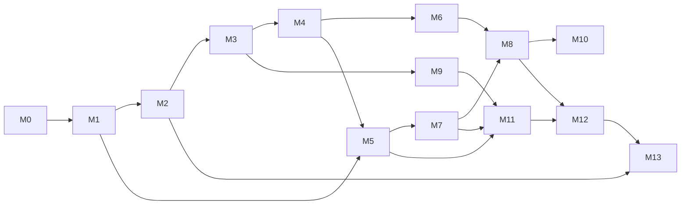

# CINEFLOW Milestones and Dependencies

Milestones reproduce the kickoff sequence. Dates and effort are intentionally absent until scope, team availability, provider, and issue access are known. Exit criteria are gates; no milestone is complete merely because documentation or code exists.

| Milestone | Outcome | Exit gate / dependency |
|---|---|---|
| M0 Project Initialization | Shared project instructions, README, status, engineering protocol, repo/issue process, role assignments | Director accepts initialization pack; repo identity/branch policy available |
| M1 Architecture and Engineering Foundation | Approved stack, ADRs, diagrams, domains, ERD, API contracts, security/failure/deployment design, quality/ops plan | Research and architecture gate signed by Architect + Director; unresolved high-risk questions assigned |
| M2 Backend and Database Foundation | Repeatable API/local DB/migration/config/logging foundation | Clean environment builds; migrations apply from empty DB; smoke/integration evidence |
| M3 Authentication and Profiles | Account lifecycle, sessions/identity, profile ownership and authorization | Security-sensitive review; cross-account tests; session/CSRF/recovery tests |
| M4 Movie Catalog | Catalog schema, admin/API and read surfaces | Contract and query tests; unpublished/restricted data is not exposed |
| M5 Content Ingestion and Licensing | Source ingestion, rights evidence/review, publication gate, audit | Rights scenario matrix passes; no media publish without valid grant |
| M6 Search and Discovery | Search/filter/catalog browse and frontend flows | Search relevance/latency baseline; authorization/territory filters; accessible UI checks |
| M7 Media Processing | Conditional on selected hosting/processing approach; isolated workers, probe/transcode/HLS packaging, staged promotion when needed | If first-party processing is selected: authorized fixtures validate; retries/partial failure/resource caps tested. If an external authorized source is selected, verify its contract and failure/security behavior instead |
| M8 Video Playback | Authorized playback and adaptive streaming are eventual product commitments; delivery may use first-party hosting or an authorized provider | Per-title rights gate; supported device matrix; expired/revoked grant denial; playback quality/error evidence |
| M9 Watchlists and History | Profile-bound favorites/watchlists/progress/history | Ownership, idempotency/conflict semantics and retention tests |
| M10 Recommendations | Recommendation capability and a measured baseline; ranking/personalization details remain open | Product/privacy approval, quality baseline, fallback behavior; sequencing may follow core catalog/playback |
| M11 Admin Dashboard | Operator workflows for catalog, rights, jobs and audit | Least-privilege role tests, audit completeness, accessible admin workflow |
| M12 Security and Performance | Independent security/performance hardening and remediation | Critical/high findings resolved or accepted; load/abuse evidence against approved targets |
| M13 Production Deployment | Production topology, rollout, backups, monitoring, runbooks, recovery | Restore/rollback/alerting/release evidence and operational owner sign-off |

## Dependency graph

M5 rights policy and source/delivery integration must be defined before any title can be published or played. M8 playback remains in the eventual product path; its MVP timing and delivery approach require approval. M7 processing is conditional on whether CINEFLOW itself ingests/transcodes media; an authorized external source may change the need for first-party processing, but not the playback commitment. M2 foundations may run alongside finalized M1 documentation only if they implement no unsettled domain contracts. DevOps can prepare local reproducibility after deployment assumptions are documented and must not silently lock in a cloud provider.

## Critical path (current)

1. Confirm repo/remote and durable branch/review workflow.
2. Accept M0 shared docs and role ownership.
3. Architect resolves M1 contracts and ADRs, with Director acceptance.
4. Decide rights territories/evidence and content source constraints before M5/M7/M8.
5. Select cloud/CDN/storage and establish cost/region targets before production streaming/deployment decisions.

## Safe parallel tracks after gate

- API/database foundation and local container foundation can proceed in parallel once runtime versions and interfaces are approved.
- Frontend shell can proceed separately from backend modules only after OpenAPI DTOs, auth/session assumptions, and design/accessibility conventions are stable.
- QA strategy and test fixture design can proceed throughout, but independent acceptance requires the actual build and evidence.
